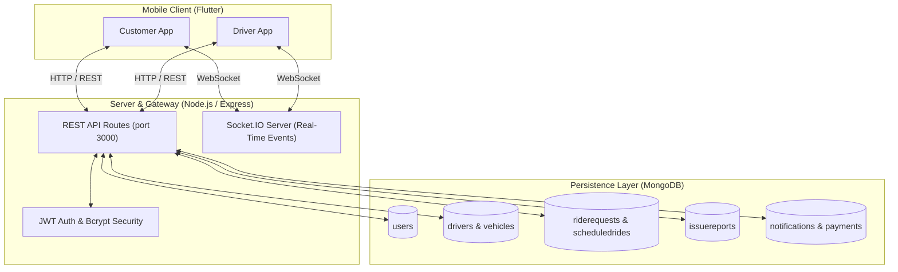
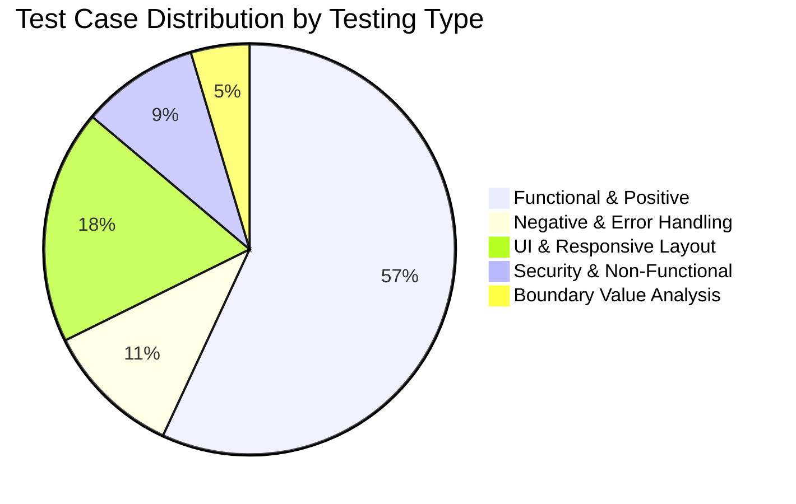

# RideAndServe — Software Testing Summary & System Architecture Overview

**Project Name:** RideAndServe — Intelligent Multi-Tier Transport & Driver Dispatch System  
**Academic Document Type:** Final Year Project (FYP) Quality Assurance & Testing Summary  
**Document Version:** 1.0.0 (Comprehensive Baseline)  
**Date:** November 2026  
**Audience:** FYP Project Supervisors, Examination Committee & Quality Assurance Engineers  

---

## 1. Executive Summary

**RideAndServe** is a cross-platform mobile and web backend application designed to streamline daily commuting, on-demand driver hiring, scheduled private pickups, and regional tourism transportation. The system connects passengers (Customers) with verified vehicle operators (Drivers), coordinated in real-time by an automated and administrative Dispatch System.

This **Testing Summary Document** provides an overview of the test engineering strategy, architecture mapping, module-wise test coverage, user roles and permissions, and execution frameworks established for the application.

---

## 2. Project Architecture & Technical Stack

| Layer | Technologies & Libraries | Key Responsibilities |
| :--- | :--- | :--- |
| **Frontend Mobile Client** | Flutter SDK (Dart 3.9+), Provider, Dio / HTTP, Google Fonts, Geolocator, Flutter Secure Storage, Socket.IO Client | Provides role-specific mobile interfaces for Customers and Drivers; handles interactive map pickers, live status tracking, push/in-app notifications, and offline resiliency. |
| **Backend REST & WebSocket** | Node.js (v18+), Express (v5.x), Socket.IO (v4.8+), Multer, Cloudinary, Nodemailer, JSONWebToken, BcryptJS | Handles business logic, authentication, sequential Request ID generation (`SCH-900X`, `HDR-XXXX`, `TT-700X`), tariff computation, and bi-directional real-time event broadcasting. |
| **Database & Persistence** | MongoDB (Mongoose v9.x), MongoDB Atlas with automatic fallback to Local MongoDB (`mongodb://127.0.0.1:27017/ride_and_serve`) | Stores transactional entities across collections: `users`, `drivers`, `vehicles`, `riderequests`, `scheduledrides`, `driverhirerequests`, `traveltourismrequests`, `issuereports`, `customernotifications`, `drivernotifications`, and `payments`. |

---

## 3. User Roles & Permission Matrix

The application enforces strict role-based access control (RBAC) across three primary actors:

| Capabilities & Permissions | Customer (Passenger) | Driver (Operator) | Admin / Dispatcher |
| :--- | :---: | :---: | :---: |
| Self-Registration & OTP Phone Verification | Yes | Yes (Multi-step + Vehicle) | Pre-seeded / System Admin |
| Book Monthly Recurring Pickup (`SCH-900X`) | Yes (Author) | View Assigned Only | Full Management / Dispatch |
| Book Hourly / Daily Dedicated Driver (`HDR-XXXX`) | Yes (Author) | View Assigned Only | Full Management / Dispatch |
| Book Travel & Tourism Outstation Package (`TT-700X`) | Yes (Author) | View Assigned Only | Full Management / Dispatch |
| Toggle Online / Offline Availability | No | Yes | View Status / Override |
| Manage Route Matching & Preferred Routes | No | Yes | View & Suggest Routes |
| View Assigned Daily Roster & Ride Management | No | Yes | Full Allocation Control |
| View Past Ride History & Itemized Tariff Breakdown | Customer History Only | Driver History + Net Earnings | Master History & Reporting |
| Report Passenger Incidents & Vehicle Issues | No | Yes (Per-Passenger & Combined) | Ingest, Review & Reassign |
| Reassign Replacement Drivers | No | No | Yes (Full Dispatch Control) |
| Request Driver Replacement on Driver Unavailable | Yes | No | Action Replacement Request |
| Process & Upload Payments (Cash / Digital Receipt) | Yes (Payer) | Yes (Cash Collector) | Verify & Reconcile |

---

## 4. Implemented Modules & Functionality Mapping

### Module 1: Customer Authentication & Profile Management
- **Endpoints:** `/api/auth/signup`, `/api/auth/login`, `/api/auth/verify-otp`, `/api/auth/resend-otp`, `/api/auth/check-phone`, `/api/auth/profile-picture`, `/api/auth/update-profile`, `/api/auth/forgot-password/*`.
- **Functionality:** Secure customer onboarding, duplicate phone prevention, 6-digit SMS OTP verification, bcrypt password hashing, JWT session management, Cloudinary-based profile image cropping and upload, profile management, and terms agreement.

### Module 2: Driver Authentication, Vehicle Onboarding & Settings
- **Endpoints:** `/driver/register`, `/driver/login`, `/vehicle/register`, `/vehicle/update`, `/password/driver/*`, `/driver/availability`, `/driver/preferred-routes`.
- **Functionality:** 4-step wizard for driver personal data, CNIC, and driving license validation; vehicle details registration (make, model, AC/Non-AC, capacity); automated `driverReferenceId` allocation; GPS location setup via `geolocator`; and availability toggling (Online / Offline).

### Module 3: Customer Ride Booking Services
- **Endpoints:** `/api/rides/monthly`, `/api/schedule-rides`, `/api/driver-hire`, `/api/travel-requests`.
- **Functionality:**
  - **Monthly Pick & Drop:** Multi-week subscription scheduling with morning and evening pickup hours.
  - **Scheduled Pickup:** One-way or round-trip future date reservations (`scheduledrides`).
  - **Hire a Driver:** On-demand private chauffeur hire by duration in hours and transmission preference (`driverhirerequests`).
  - **Travel & Tourism:** Inter-city and northern areas tour packages with seat and luggage options (`traveltourismrequests`).
  - **Location Map Picker:** Draggable map pin picker with reverse-geocoding into human-readable Pakistani addresses.
  - **Tariff Engine:** Distance-based fare calculation with vehicle class multipliers.

### Module 4: Driver Dashboard, Ride Management & Ride History
- **Endpoints:** `/api/rides/driver/:driverId`, `/api/rides/driver/:driverId/history`.
- **Functionality:**
  - 6-Card responsive menu grid on dashboard.
  - Active ride management lifecycle: `ASSIGNED` -> `ACCEPTED` -> `ON_THE_WAY` -> `ARRIVED` -> `PICKED_UP` -> `COMPLETED`.
  - Dedicated **Ride History** interface with total earnings banner, timeframe filters (`Today`, `Weekly`, `Monthly`, `All`), status tabs (`All`, `Completed`, `Cancelled`), customer search, and trip breakdown modal displaying base fare, distance charge, waiting fee, and platform commission.
  - Card 6 **Profile View** integration allowing direct access to driver settings and credentials.

### Module 5: Incident Reporting & Passenger Management (Hardened Flow)
- **Endpoints:** `POST /api/driver/report-issue`.
- **Functionality:**
  - **Per-Passenger Incident Logging (Separate Mode):** Driver selects affected passengers and chooses from standard issue reasons (Heavy Rain, Vehicle Breakdowns, Traffic, Bad Weather, Passenger Issue, Delay, Road Blockage).
  - **Local UI Isolation:** Selecting a reason updates UI state locally with **zero premature HTTP requests**, preventing premature alerts to the admin.
  - **Single Canonical Write:** Clicking "Send to Admin" writes a single clean document to `IssueReport` without duplicate collection spam.
  - **Multi-Key Linkage:** Locates the ride by `p.requestId` (`REQ-803X`), `p.mongoId`, or `p.id`, updates status to `Driver Unavailable`, and generates real-time customer notifications.

### Module 6: Admin Dispatch, Driver Reassignment & State Clearance
- **Endpoints:** `POST /api/rides/:id/dispatch`, `POST /admin/rides/:id/dispatch`.
- **Functionality:**
  - Dispatches initial or replacement drivers.
  - **Issue State Purge:** Explicitly sets `driverIssue: null` when reassigning a driver to an unavailable ride, ensuring the replacement driver receives a completely clean ride state.
  - Emits real-time `ride-dispatched` socket events to the replacement driver's dedicated room and updates `replacementrequests`.

### Module 7: Real-Time Socket.IO Synchronization & Notification Engine
- **Endpoints:** WebSocket on port `3000` / `/socket.io`.
- **Functionality:**
  - Auto-joins driver rooms (`driver_<id>`, `driver_<name>`) and customer rooms (`customer_<id>`, `ride_<id>`).
  - Dispatches live ride popup alerts in under 1 second.
  - Broadcasts customer status transitions (`ride_accepted`, `driver_unavailable`).
  - Automated background service purges assigned notifications older than 24 hours.

### Module 8: Payment Processing & Financial Billing
- **Endpoints:** `POST /api/payments/upload`, `GET /api/payments/history`.
- **Functionality:** Cash collection on drop-off, digital wallet and bank receipt attachment upload, customer payment transaction ledger, and driver payout reconciliation.

### Module 9: Security, Resilience & Concurrency
- **Functionality:** Protected API endpoints via JWT tokens, bcrypt password encryption, double-tap prevention on submit buttons, 8-second network timeout recovery, international UTF-8 encoding support, and uniform JSON error responses.

---

## 5. Test Suite Distribution & Coverage Metrics

A total of **65 comprehensive test cases** have been created to thoroughly evaluate the system:

### Module-Wise Test Case Breakdown

| Module ID | Module Name | P0 (Critical) | P1 (High) | P2 (Medium) | Total Cases |
| :---: | :--- | :---: | :---: | :---: | :---: |
| **1** | Customer Authentication & Profile Management | 6 | 6 | 1 | **13** |
| **2** | Driver Authentication & Vehicle Onboarding | 5 | 3 | 1 | **9** |
| **3** | Customer Ride Booking (Monthly, HDR, TT) | 4 | 3 | 0 | **7** |
| **4** | Driver Operations & Ride History | 4 | 4 | 1 | **9** |
| **5** | Incident Reporting & Passenger Management | 5 | 2 | 0 | **7** |
| **6** | Admin Dispatch & Driver Reassignment | 4 | 1 | 0 | **5** |
| **7** | Real-Time Socket.IO & Notification Engine | 4 | 2 | 0 | **6** |
| **8** | Payment Processing & Financial Billing | 2 | 1 | 0 | **3** |
| **9** | Security, Resilience & Concurrency | 2 | 3 | 1 | **6** |
| **TOTAL** | **Full System Test Suite** | **36** | **25** | **4** | **65** |

---

## 6. Test Environment Configuration & Setup

### 6.1 Server Configuration
- **Runtime:** Node.js v18.x / v20.x on Windows / Linux
- **Framework:** Express.js v5.2.1
- **Database:** MongoDB Community 7.0 / MongoDB Atlas (`process.env.MONGO_URL`)
- **Port Binding:** `0.0.0.0:3000` (allowing mobile device connectivity over Wi-Fi)

### 6.2 Mobile Client Configuration
- **Framework:** Flutter SDK v3.9.2+ (Channel stable)
- **Target OS:** Android 11.0+ (API 30+) / iOS 15.0+
- **Network Configuration:** Configured in `Frontend/lib/constants/api_constants.dart` with auto-selection between Local IP (`http://192.168.88.114:3000`) and live production endpoint.

---

## 7. Quality Assurance Sign-Off & Review Guidelines

For academic review and evaluation committees:
1. **Traceability:** Every test case in [`Test_Cases.md`](file:///c:/RideAndServe/Testing_Documentation/Test_Cases.md) directly maps to an active controller method, route, schema, and Flutter screen.
2. **Defect Tracking:** Known defects, legacy issues that have been patched, and potential edge cases are cataloged in [`Bug_Report.md`](file:///c:/RideAndServe/Testing_Documentation/Bug_Report.md).
3. **Execution Readiness:** All test cases are initialized with `Actual Result: Pending Execution` and `Status: Not Tested` to facilitate live demonstration and audit runs.

---
*End of Test Summary Document.*
